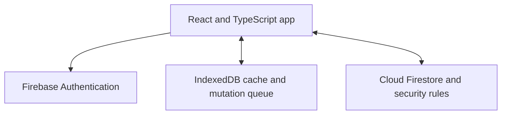

# Where I Left Off

[](https://github.com/AdamAbuToamy/where-i-left-off/actions/workflows/ci.yml)

**Save the link, remember where you stopped, and know what to do next.**

A multilingual project and study organizer built with React, TypeScript and Firebase. Organize personal cards and shared work, plan university courses and weekly classes, and use a floating Qwen assistant to review and apply changes.

**[Try the live app](https://where-i-left-off.web.app/)** · **[About Where I Left Off](https://where-i-left-off.web.app/about.html)** · **[العربية](README_AR.md)** · **[Test results](TEST_RESULTS.md)** · **[Security](SECURITY.md)**

<!-- recall-media:start -->
## Promotional preview

<a href="docs/media/README.md"></a>

Promotional illustration; not a screenshot of the live interface.

**[English video](docs/media/videos/promo-en.mp4)** · **[Arabic video](docs/media/videos/promo-ar.mp4)** · **[Full media gallery](docs/media/README.md)** · **[Phone installation illustrations](docs/media/README.md#phone-installation-illustrations--رسومات-تثبيت-الهاتف)**

<!-- recall-media:end -->

## Why I built it

A saved tab tells you where to return, but not where you stopped. A task title tells you what to do, but not the context you need to resume. Where I Left Off keeps the link, checkpoint and next step together in one card.

For example: save a university assignment, record “finished questions 1–2”, and set the next step to “start question 3”. Return to that card from your phone or computer.

## Features

| Area | Available features |
| --- | --- |
| Personal organization | Cards, custom sections, saved links, checkpoints, checklists and follow-up dates |
| Quick views | Search, status/date filters, a weekly view and University Today inside Continue Now |
| Offline work | Device-local edits, reload persistence, synchronization on reconnect and explicit conflict choices |
| Shared groups | Invitations, task assignment, membership management and member creation permissions |
| Languages | Arabic, Hebrew and English, including right-to-left layout |
| Mobile and desktop | Responsive UI and keyboard, mouse and touch card sorting |
| Sign-in | Firebase email/password and Google authentication |
| Web app | Installable PWA, offline application shell and an Android share-target declaration |
| Browser capture | User-activated Chromium extension for tab/video capture and recognized Moodle course/task pages, with a preview before import |
| University | Courses, study-topic checklists, assignments, exams, notes, prerequisite maps and a weekly timetable with room and session type |
| Assistant | Floating chat for summaries, advice, TXT downloads and reviewed changes to cards, courses, tasks and timetable sessions |

This is an experimental beta. Native phone installation/share sheets and real Google OAuth still need documented physical-device verification.

## University semester planner

The University page is available to accounts with a verified email address. Add courses, notes, study topics, assignments and exams; link prerequisites in an editable map; and build a weekly timetable with lectures, tutorials, labs, days, times and rooms. University Today appears inside Continue Now, showing today's classes, deadlines and overdue tasks.

University records synchronize through private, account-scoped Firestore records. Local storage and an outbox preserve edits during disconnection, with explicit conflict resolution after reconnecting. Spreadsheet paste supports preview, duplicate detection and timetable overlap warnings. JSON export/import remains available for backups. Phone reminders require separate opt-in.

The current extension can recognize supported Moodle course/task pages that the user opens and explicitly chooses to capture. It does not establish a permanent Moodle account connection or automatically poll for new assignments. See [the university guide](docs/UNIVERSITY_PILOT_AR.md) and [extension instructions](browser-extension/README_AR.md).

## Qwen assistant

Open the floating assistant from the signed-in workspace to ask about saved data, request summaries or advice, download plain-text files, and propose changes to cards, courses, tasks, prerequisites and timetable sessions. Review the proposal and choose **Apply changes** to save it. Writes use the same Firebase permissions as the user, check for conflicting edits, and are confirmed from the server before success is shown. Supported undo operations also refuse to overwrite later edits. Tasks linked to phone reminders are edited in University to keep the reminder schedule consistent.

- **Cloud mode:** Qwen3-30B-A3B through the existing Cloudflare Worker. Configure it with `node scripts/setup-free-assistant.mjs`. Provider free quotas apply; the app has a short anti-burst interval, not the former ten-attempt daily cap.
- **Optional on-device mode:** choose **Run Qwen on this device** in the chat. Qwen2.5 1.5B runs through WebLLM in a Web Worker after an explicit, large first download (about 1 GB). It requires WebGPU and sufficient GPU memory (the model configuration lists about 1.6 GB). It has no AI-provider message quota; speed, output quality and context capacity depend on the device. Firebase connectivity is still needed to synchronize and save approved changes. Local-mode failures do not silently send the request to the cloud.
- **Clear supported commands:** some course, card and timetable commands are handled directly without model inference. Other phrasing uses the selected model.

Chat replies and UI follow Arabic, English or Hebrew. The panel includes animated waiting states for reading data, preparing a reply and saving, plus real model-download progress and reduced-motion support. The assistant uses saved content, does not browse linked pages, and does not execute generated code. See [assistant task acceptance evidence and limitations](docs/AI_ACCEPTANCE_AR.md) and [privacy](https://where-i-left-off.web.app/privacy.html). On-device GPU inference quality and speed have not been validated in the development environment; the tested persistence path and mocked model contracts do not establish that every natural-language request succeeds.

## Try it

1. Open [where-i-left-off.web.app](https://where-i-left-off.web.app/) and create an account or sign in.
2. Add a card with a title, a link if needed, and your next step.
3. Add a checkpoint, section, checklist or follow-up date when useful.
4. Open the same account on another device to access synchronized cards.

Open and sign in online before relying on offline use. Queued changes sync while the app is open online; background synchronization with the app closed is not promised.

For home-screen installation on Android and iPhone, see [the installation guide](docs/INSTALL.md). For desktop tab capture, see [the extension guide](browser-extension/README_AR.md).

## Architecture



Firebase Authentication provides identity. Firestore rules enforce ownership, membership and permissions on the server. IndexedDB keeps cached data and queued changes separated by account and workspace. A service worker caches the application shell. Revision checks and explicit conflict resolution protect concurrent edits.

The client admin dashboard is limited to activity metrics and app-access suspension. Its rules do not grant access to personal card content. See [security scope](SECURITY.md).

## Run locally

Requires **Node.js 24**, npm, and **Java 21** for emulator tests.

```bash
npm ci --include=dev
cp .env.example .env.local
# Add your own Firebase web configuration to .env.local.
npm run dev
```

In your Firebase project, enable Firestore and the Email/Password and Google sign-in providers. Configure the authorized domains for your deployment. Firebase client configuration is not a service-account credential; keep access tokens and private keys out of Git.

To use the test emulators without production credentials, run in separate terminals:

```bash
npm run emulators
npm run dev:emulator
```

## Tests and checks

```bash
npx playwright install --with-deps chromium
npm ci --prefix push-worker
npm test --prefix push-worker
npm audit --omit=dev --audit-level=high
npm run test:all
```

The latest local validation passed **229 unit/component tests, 52 Firestore/security and chat-acceptance tests, and 34 Worker tests**, along with ESLint and the production build. Chat acceptance tests use the actual Apply button and read saved results from a Firestore emulator; model-adapter tests use injected responses. See [assistant acceptance evidence](docs/AI_ACCEPTANCE_AR.md). [TEST_RESULTS.md](TEST_RESULTS.md) retains earlier validation history.

CI runs on pushes and pull requests using demo Firebase emulators, including browser tests and a dependency audit. It does not deploy or require production credentials. Check [GitHub Actions](https://github.com/AdamAbuToamy/where-i-left-off/actions) for the current browser and audit results. Do not run E2E and production builds concurrently: both write `dist`.

For the documented WSL test runner and dependency override compatibility, see [tooling maintenance](docs/TOOLING_SECURITY.md).

## Deployment

```bash
VITE_USE_EMULATORS=false VITE_TEST_OFFLINE=false npm run build
```

The included `scripts/deploy-production.sh` is configured for the maintainer's Firebase project and hosting target. Forks should use their own Firebase project, hosting target and deployed rules. Hosting and Firestore free quotas are finite; the project does not guarantee unlimited free usage.

## Scope and next steps

The current app includes the university planner, assistant and opt-in installed-app reminders described here. External reply monitoring, binary attachment uploads, nested sections and permanent background Moodle synchronization are not implemented. [The roadmap](ROADMAP_AR.md) records earlier plans; the feature list above describes the current implementation.

Automated checks do not establish complete coverage, penetration-test certification or production IAM/abuse resistance. Offline copies cannot be remotely erased after access is revoked. Group administration needs connectivity. These limits are documented in [SECURITY.md](SECURITY.md).

Built by **[Adam Abu Toamy](https://www.linkedin.com/in/adam-abu-toamy-383250363/)**.

## Architecture and browser credentials

See [architecture decisions](docs/ARCHITECTURE.md) for domain objects, storage interfaces, adapters and the production write path. See [credential boundaries](docs/CLIENT_SECURITY.md) for public Firebase identifiers, server-only secrets, deployment guards and cloud settings that require account-side verification.

`npm run build` checks browser source/assets before bundling and generated assets afterward for credential patterns. Unknown `VITE_*` variables are rejected. `scripts/deploy-production.sh` requires complete Firebase configuration and a public reCAPTCHA Enterprise site key; deploy only after verifying App Check metrics and enforcement in the Firebase project.

## More projects by Adam Abu Toamy

[**DeskPages — Windows 11 desktop icon organizer**](https://github.com/AdamAbuToamy/DeskPages) organizes the original Windows desktop into pages while keeping file paths unchanged. [Downloads and release notes](https://github.com/AdamAbuToamy/DeskPages/releases).


## Free installed-app notifications / إشعارات التطبيق المثبّت

Opt-in Web Push reminders use Cloudflare Workers Free, D1 and Queues. Firebase stays on Spark; no Blaze upgrade or payment card is required for this deployment. Free quotas apply and service may pause when exhausted. Configure the separate Worker before publishing the app. See [setup and phone testing](docs/PUSH_NOTIFICATIONS_AR.md).
