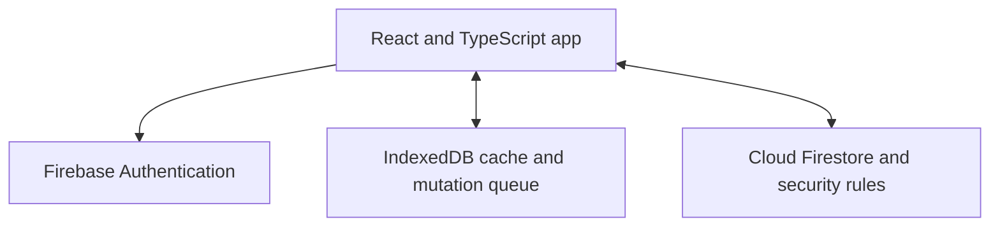

# Where I Left Off

[](https://github.com/AdamAbuToamy/where-i-left-off/actions/workflows/ci.yml)

**Save the link, remember where you stopped, and know what to do next.**

A multilingual project and follow-up organizer built with React, TypeScript and Firebase. Keep personal cards private, coordinate tasks in shared groups, and continue working with cached cards offline.

**[Try the live app](https://where-i-left-off.web.app/)** · **[About Where I Left Off](https://where-i-left-off.web.app/about.html)** · **[العربية](README_AR.md)** · **[Test results](TEST_RESULTS.md)** · **[Security](SECURITY.md)**

<!-- recall-media:start -->
## Promotional preview

<a href="docs/media/README.md"></a>

Promotional illustration; not a screenshot of the live interface.

**[English video](docs/media/videos/promo-en.mp4)** · **[Arabic video](docs/media/videos/promo-ar.mp4)** · **[Full media gallery](docs/media/README.md)** · **[Phone installation illustrations](docs/media/README.md#phone-installation-illustrations--رسومات-تثبيت-الهاتف)**

<!-- recall-media:end -->

## Why I built it

A saved tab tells you where to return, but not where you stopped. A task title tells you what to do, but not the context you need to resume. Where I Left Off keeps the link, checkpoint and next step together in one card.

For example: save a university assignment, record “finished questions 1–2”, and set the next step to “start question 3”. Return to that card from your phone or computer.

## Features

| Area | Available in V1 |
| --- | --- |
| Personal organization | Cards, custom sections, saved links, checkpoints, checklists and follow-up dates |
| Quick views | Search, status/date filters and a weekly view |
| Offline work | Device-local edits, reload persistence, synchronization on reconnect and explicit conflict choices |
| Shared groups | Invitations, task assignment, membership management and member creation permissions |
| Languages | Arabic, Hebrew and English, including right-to-left layout |
| Mobile and desktop | Responsive UI and keyboard, mouse and touch card sorting |
| Sign-in | Firebase email/password and Google authentication |
| Web app | Installable PWA, offline application shell and an Android share-target declaration |
| Browser capture | Unpacked desktop Chromium extension, activated by the user to capture the current tab title and URL |

This is an experimental beta. Native phone installation/share sheets and real Google OAuth still need documented physical-device verification.

## Try it

1. Open [where-i-left-off.web.app](https://where-i-left-off.web.app/) and create an account or sign in.
2. Add a card with a title, a link if needed, and your next step.
3. Add a checkpoint, section, checklist or follow-up date when useful.
4. Open the same account on another device to access synchronized cards.

Open and sign in online before relying on offline use. Queued changes sync while the app is open online; background synchronization with the app closed is not promised.

For home-screen installation on Android and iPhone, see [the installation guide](docs/INSTALL.md). For desktop tab capture, see [the extension guide](browser-extension/README_AR.md).

## Architecture



Firebase Authentication provides identity. Firestore rules enforce ownership, membership and permissions on the server. IndexedDB keeps cached data and queued changes separated by account and workspace. A service worker caches the application shell. Revision checks and explicit conflict resolution protect concurrent edits.

The client admin dashboard is limited to activity metrics and app-access suspension. Its rules do not grant access to personal card content. See [security scope](SECURITY.md).

## Run locally

Requires **Node.js 24**, npm, and **Java 21** for emulator tests.

```bash
npm ci --include=dev
cp .env.example .env.local
# Add your own Firebase web configuration to .env.local.
npm run dev
```

In your Firebase project, enable Firestore and the Email/Password and Google sign-in providers. Configure the authorized domains for your deployment. Firebase client configuration is not a service-account credential; keep access tokens and private keys out of Git.

To use the test emulators without production credentials, run in separate terminals:

```bash
npm run emulators
npm run dev:emulator
```

## Tests and checks

```bash
npx playwright install --with-deps chromium
npm run test:tooling
npm audit --audit-level=high
npm run test:all
```

The validated suite has **44 tests: 20 unit, 14 Firestore security/repository and 10 browser tests**. The browser suite also passed three consecutive local runs. Full-tree npm audit reported **0 known vulnerabilities** on 2026-10-13. [Evidence and scope](TEST_RESULTS.md) explain what these results cover.

CI runs on pushes and pull requests, including a blocking dependency audit and tooling compatibility checks. It uses demo Firebase emulators and does not deploy or require production credentials. Do not run E2E and production builds concurrently: both write `dist`.

For the documented WSL test runner and dependency override compatibility, see [tooling maintenance](docs/TOOLING_SECURITY.md).

## Deployment

```bash
VITE_USE_EMULATORS=false VITE_TEST_OFFLINE=false npm run build
```

The included `scripts/deploy-production.sh` is configured for the maintainer's Firebase project and hosting target. Forks should use their own Firebase project, hosting target and deployed rules. Hosting and Firestore free quotas are finite; the project does not guarantee unlimited free usage.

## Scope and next steps

V1 includes the features above. AI assistance, external reply monitoring, binary attachment uploads, nested sections and external reminders are not implemented. See [the roadmap](ROADMAP_AR.md).

Automated checks do not establish complete coverage, penetration-test certification or production IAM/abuse resistance. Offline copies cannot be remotely erased after access is revoked. Group administration needs connectivity. These limits are documented in [SECURITY.md](SECURITY.md).

Built by **[Adam Abu Toamy](https://www.linkedin.com/in/adam-abu-toamy-383250363/)**.

## Architecture and browser credentials

See [architecture decisions](docs/ARCHITECTURE.md) for domain objects, storage interfaces, adapters and the production write path. See [credential boundaries](docs/CLIENT_SECURITY.md) for public Firebase identifiers, server-only secrets, deployment guards and cloud settings that require account-side verification.

`npm run build` checks browser source/assets before bundling and generated assets afterward for credential patterns. Unknown `VITE_*` variables are rejected. `scripts/deploy-production.sh` requires complete Firebase configuration and a public reCAPTCHA Enterprise site key; deploy only after verifying App Check metrics and enforcement in the Firebase project.

## More projects by Adam Abu Toamy

[**DeskPages — Windows 11 desktop icon organizer**](https://github.com/AdamAbuToamy/DeskPages) organizes the original Windows desktop into pages while keeping file paths unchanged. [Downloads and release notes](https://github.com/AdamAbuToamy/DeskPages/releases).


## Free installed-app notifications / إشعارات التطبيق المثبّت

Opt-in Web Push reminders use Cloudflare Workers Free, D1 and Queues. Firebase stays on Spark; no Blaze upgrade or payment card is required for this deployment. Free quotas apply and service may pause when exhausted. Configure the separate Worker before publishing the app. See [setup and phone testing](docs/PUSH_NOTIFICATIONS_AR.md).

## University semester planner

Verified students can organize courses, study-topic checklists, assignments, exams, weekly lessons and prerequisite maps. Paste spreadsheet rows with a preview, duplicate detection and timetable conflict warnings. University records remain in browser storage scoped to the account and project; export and restore JSON to move them between devices. Phone reminders require explicit opt-in. No institutional credentials or background LMS connection are used. See docs/UNIVERSITY_PILOT_AR.md.
