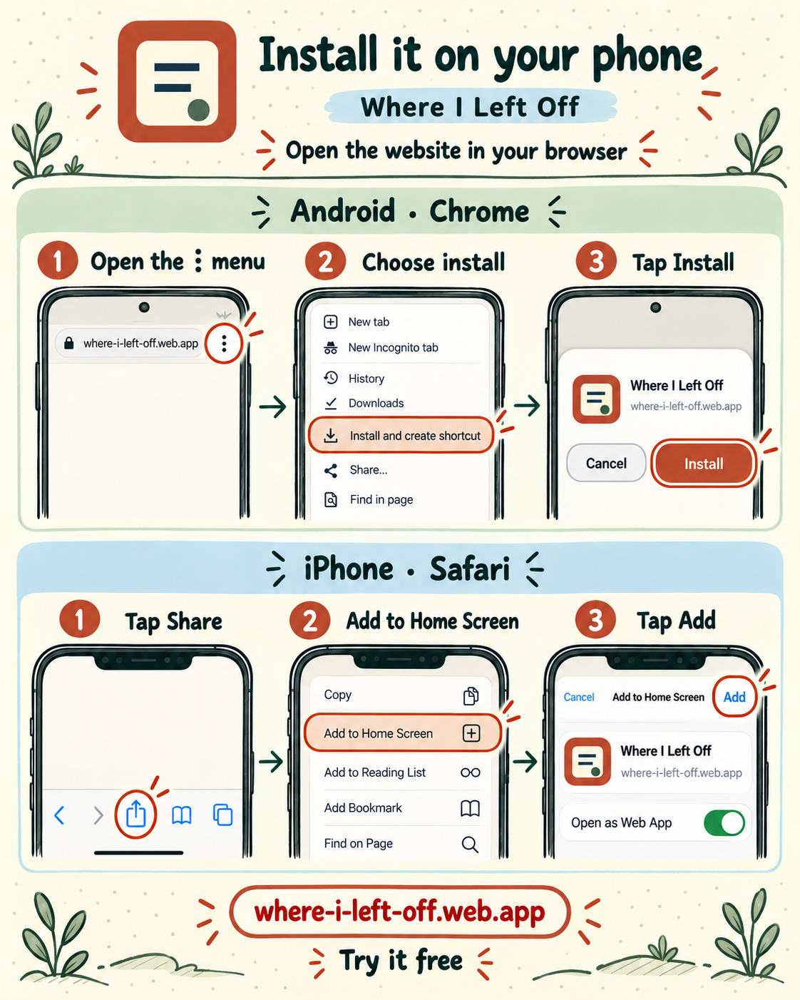
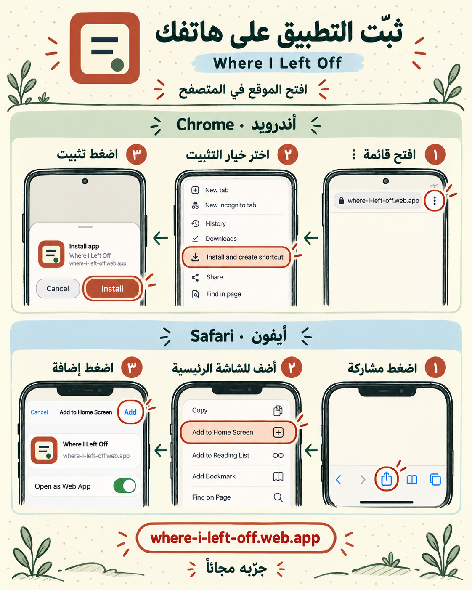

# Promotional media / المواد التعريفية

[Live application](https://where-i-left-off.web.app/) · [Project README](../../README.md) · [العربية](../../README_AR.md) · [Installation steps](../INSTALL.md)

These are promotional illustrations and animated UI recreations supplied by the maintainer. They explain the idea and visual identity; they are not screenshots or screen recordings of a running app. Illustrated cards and browser menus may simplify the live interface. The “Chat” tab is a saved-page example, not an in-app chat integration.

هذه مواد إعلانية ومحاكاة بصرية لشرح الفكرة، وليست لقطات شاشة فعلية أو دليلًا على اختبار أجهزة الهاتف. كلمة «محادثة» في الملصق مثال لصفحة محفوظة، ولا تعني وجود نظام محادثة داخل التطبيق.

## Short videos / الفيديوهات القصيرة

| Language | Video | Format |
| --- | --- | --- |
| English | [Open or download English promo](videos/promo-en.mp4) | About 10 seconds, portrait 1080×1920, H.264 video + AAC audio |
| العربية | [فتح أو تنزيل الإعلان العربي](videos/promo-ar.mp4) | نحو 10 ثوانٍ، عمودي 1080×1920، فيديو H.264 وصوت AAC |

The MP4 files are included unchanged. GitHub Markdown links to them; playback/download behavior depends on the browser. Neither short promo is a complete installation tutorial.

## Pick up where you left off / ارجع وكمل

| English | العربية |
| --- | --- |
|  |  |

## Turn saved tabs into next steps / من التبويبات للخطوة الجاية

| English | العربية |
| --- | --- |
|  |  |

## Phone installation illustrations / رسومات تثبيت الهاتف

Browser/OS menus vary by version and language. Use the [written installation guide](../INSTALL.md) for the steps and official references. These drawings do not establish that every native installation dialog was tested.

| English | العربية |
| --- | --- |
|  |  |

## File integrity

[assets.json](assets.json) records file sizes and SHA-256 hashes. All eight media assets are byte-identical to the supplied files; filenames were normalized for repository links. Original artwork and narration were not regenerated or edited for this gallery.
